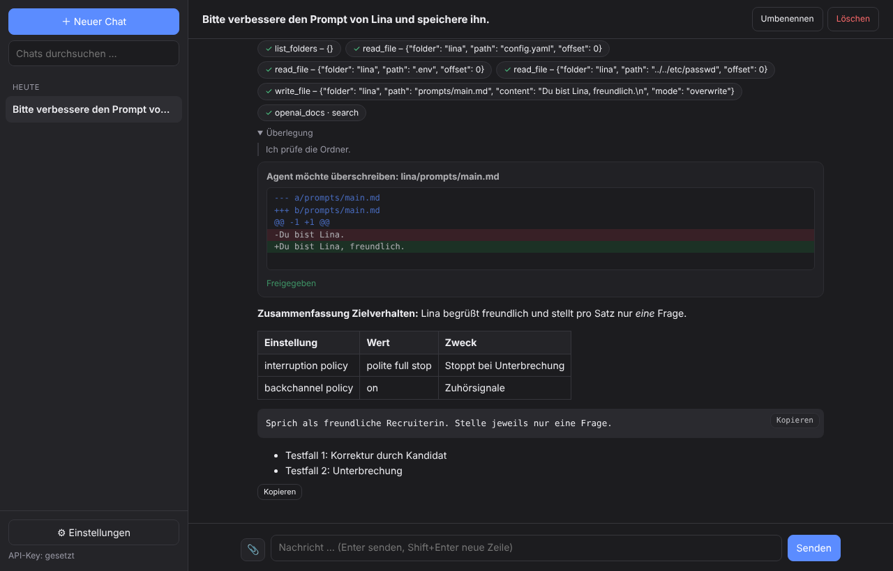
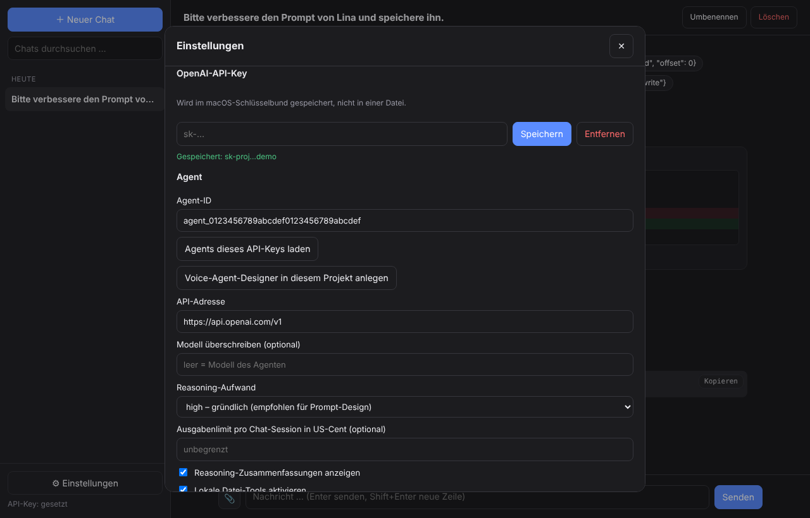
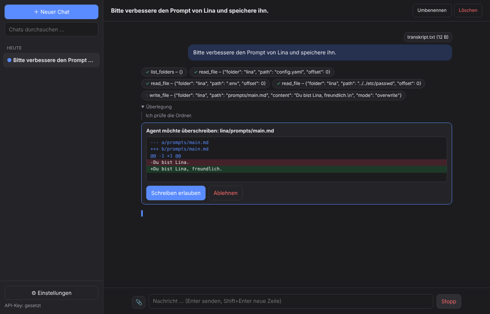

# Agent Chat

**Native macOS-Chat-App für Agenten der OpenAI Agents API** – gebaut für den *Voice-Agent-Designer und Prompt-Berater*, nutzbar mit jedem gespeicherten Agenten.

Chat mit Verlauf, Uploads und kontrolliertem Zugriff auf deine Projektordner: Der Agent darf lesen, was du freigibst, und schreiben nur, wenn du jede Änderung als Diff bestätigst.



[](https://github.com/dsactivi-2/API_AGENT_APP/actions/workflows/ci.yml)

---

## Inhalt

- [Funktionen](#funktionen)
- [Voraussetzungen](#voraussetzungen)
- [Installation](#installation)
- [Erster Start](#erster-start)
- [Bedienung](#bedienung)
- [Dateizugriff und Freigaben](#dateizugriff-und-freigaben)
- [Konfiguration](#konfiguration)
- [Architektur](#architektur)
- [Projektstruktur](#projektstruktur)
- [Entwicklung und Tests](#entwicklung-und-tests)
- [Agent-Konfiguration pflegen](#agent-konfiguration-pflegen)
- [Fehlerbehebung](#fehlerbehebung)
- [Bekannte Grenzen](#bekannte-grenzen)
- [Sicherheit](#sicherheit)

---

## Funktionen

| Bereich | Was die App kann |
|---|---|
| **Chat** | Streaming-Antworten, Markdown mit Tabellen, Codeblöcke mit Kopieren-Button, Stopp-Button, Reasoning-Zusammenfassungen (abschaltbar) |
| **Agent-Aktivität** | Tool-Aufrufe (Web-Suche, MCP, lokale Tools) erscheinen live als Chips mit Status |
| **Verlauf** | Alle Chats lokal (SQLite), nach Datum gruppiert, Volltextsuche, Umbenennen, Löschen |
| **Uploads** | 📎-Button, Drag & Drop, Einfügen aus der Zwischenablage. Text, Code, PDF und DOCX werden als Text übergeben, Bilder als Bild |
| **Dateizugriff** | Agent liest, durchsucht und schreibt in freigegebenen Ordnern – Schreiben nur mit Diff-Vorschau und deiner Bestätigung |
| **Agent-Verwaltung** | Agents des API-Keys auflisten, Voice-Agent-Designer per Klick im Projekt des Keys anlegen, Verbindungstest |
| **Steuerung** | Modell- und Reasoning-Override pro App, Ausgabenlimit pro Chat-Session |
| **macOS** | Eigenes Fenster und Icon, Hell/Dunkel nach System, API-Key im Schlüsselbund, Benachrichtigung wenn eine Antwort fertig ist |

---

## Voraussetzungen

- macOS 12 oder neuer (Apple Silicon oder Intel)
- Python ≥ 3.10 – z. B. `brew install python@3.12`
- OpenAI-API-Key (`sk-…`) aus einem Projekt mit Zugriff auf die **Agents API (Beta)**
- Zugriff auf das Modell des Agenten (Vorlage: `gpt-6-astra`)

---

## Installation

```bash
git clone https://github.com/dsactivi-2/API_AGENT_APP.git ~/Projects/agent-chat
cd ~/Projects/agent-chat
bash install.sh --open
```

`install.sh`

1. sucht ein passendes Python (≥ 3.10),
2. legt `.venv/` an und installiert die Abhängigkeiten,
3. baut `~/Applications/Agent Chat.app` mit Icon,
4. startet die App (`--open`).

Danach startest du die App wie jede andere – Spotlight: **Agent Chat**.

**Update:** `git pull && bash install.sh`. Chats, Einstellungen und API-Key bleiben erhalten.

> Den Ordner nach der Installation nicht verschieben – die App startet den Code von dort. Falls doch: `bash install.sh` im neuen Ordner erneut ausführen.

---

## Erster Start

Beim ersten Start öffnen sich die Einstellungen automatisch.

1. **API-Key** eintragen → **Speichern** (landet im macOS-Schlüsselbund).
2. **Agent wählen** – eine der beiden Möglichkeiten:
   - **„Voice-Agent-Designer in diesem Projekt anlegen“** – legt den Agenten aus [`app/agent_template.json`](app/agent_template.json) im Projekt deines Keys an und wählt ihn aus.
   - **„Agents dieses API-Keys laden“** – vorhandenen Agenten aus der Liste wählen.
3. **Verbindung testen** – erwartet: `OK: <Name> · Modell … · Reasoning … · Tools: …`
4. Optional: **Freigegebene Ordner** hinzufügen (siehe unten).
5. **Speichern**, dann **＋ Neuer Chat**.



> **Wichtig:** Agents gehören immer zu genau einem OpenAI-Projekt. Ein Key sieht nur die Agents seines eigenen Projekts. Meldet der Verbindungstest „gehört nicht zum Projekt dieses API-Keys“, nimm einen Key aus dem Projekt des Agenten oder lege den Agenten im Projekt deines Keys an.

---

## Bedienung

| Aktion | So geht's |
|---|---|
| Senden | `Enter` (neue Zeile: `Shift + Enter`) |
| Datei anhängen | 📎, Datei ins Fenster ziehen oder `Cmd + V` |
| Antwort abbrechen | **Stopp** |
| Code / Antwort kopieren | **Kopieren** am Codeblock bzw. unter der Antwort |
| Chat finden | Suchfeld links (durchsucht Titel und Nachrichten) |
| Chat umbenennen / löschen | Buttons oben rechts im Chat |

Jeder Chat hat eine eigene Session bei OpenAI. Ist sie abgelaufen, startet die App automatisch eine neue und weist darauf hin – der Agent kennt den früheren Verlauf dann nicht mehr.

---

## Dateizugriff und Freigaben

In den Einstellungen unter **Freigegebene Ordner** legst du fest, worauf der Agent zugreifen darf:

| Modus | Agent darf |
|---|---|
| **Nur lesen** | auflisten, lesen, durchsuchen |
| **Lesen + Schreiben** | zusätzlich Dateien anlegen, überschreiben, anhängen – **jedes Mal mit deiner Freigabe** |

Will der Agent schreiben, zeigt die App einen Diff:



**Lokale Tools des Agenten**

| Tool | Zweck |
|---|---|
| `list_folders` | freigegebene Ordner und deren Modus |
| `list_directory` | Dateien und Unterordner auflisten |
| `read_file` | Textdatei lesen (abschnittsweise, Secrets geschwärzt) |
| `search_files` | Text in Dateien suchen |
| `write_file` | Datei schreiben – nur nach Freigabe |
| `inspect_project` | Voice-Agent-Projekt nach Fokus lesen (`overview`, `prompts`, `configuration`, `dependencies`, `tests`) |

Löschen, Verschieben und Befehle ausführen sind **nicht** möglich. Details: [SECURITY.md](SECURITY.md).

---

## Konfiguration

| Einstellung | Standard | Bedeutung |
|---|---|---|
| API-Key | – | OpenAI-Key, gespeichert im Schlüsselbund (Eintrag „AgentChat“) |
| Agent-ID | – | `agent_…` des zu nutzenden Agenten |
| API-Adresse | `https://api.openai.com/v1` | `OPENAI_BASE_URL` aus der Umgebung wird bewusst ignoriert |
| Modell überschreiben | leer | anderes Modell nur für Chats in der App |
| Reasoning-Aufwand | wie im Agent | `low` / `medium` / `high` / `xhigh` nur für Chats in der App |
| Ausgabenlimit | unbegrenzt | Limit pro Chat-Session in US-Cent |
| Reasoning-Zusammenfassungen | an | „Überlegung“ im Chat anzeigen |
| Lokale Datei-Tools | an | Datei-Tools für den Agenten anbieten |

Overrides gelten nur für **neue** Chats und ändern den gespeicherten Agenten bei OpenAI nicht.

**Speicherorte**

| Was | Wo |
|---|---|
| Chats, Einstellungen, Uploads | `~/Library/Application Support/AgentChat/` |
| API-Key | macOS-Schlüsselbund, Dienst „AgentChat“ |
| Log | `~/Library/Logs/AgentChat.log` |
| App | `~/Applications/Agent Chat.app` |

**Umgebungsvariablen** (nur für Entwicklung und Tests)

| Variable | Wirkung |
|---|---|
| `AGENTCHAT_DATA_DIR` | anderer Datenordner |
| `AGENTCHAT_PORT` | fester Port statt zufälligem |
| `AGENTCHAT_HEADLESS=1` | kein Fenster, URL wird ausgegeben |
| `AGENTCHAT_ALLOW_ENV_KEY=1` | `OPENAI_API_KEY` aus der Umgebung zulassen |

---

## Architektur

```
┌──────────────── Agent Chat.app ────────────────┐
│  pywebview-Fenster (WebKit)                    │
│    └─ app/static: HTML/CSS/JS, Markdown        │
│             │  HTTP + Server-Sent Events       │
│             ▼  (127.0.0.1, Sitzungstoken)       │
│  FastAPI-Server (app/server.py)                │
│    ├─ db.py       Verlauf (SQLite)             │
│    ├─ uploads.py  Uploads → Text/Bild          │
│    ├─ files.py    Datei-Tools, Schwärzung      │
│    └─ agent.py    Sessions, Turns, Freigaben   │
└────────────────────────┬───────────────────────┘
                         │ openai-python (Agents API, Beta)
                         ▼
          OpenAI: Agent · Modell · Web-Suche · MCP
```

**Ablauf eines Turns**

1. Neue Session: `sessions.create(environment={"type": "none"}, agent_id=…, input=[Nachricht], stream=True, tool_handlers=…)`. Die erste Nachricht muss beim Anlegen mitgeschickt werden.
2. Folgenachricht: `sessions.stream(session_id, input=[Nachricht], tool_handlers=…)`.
3. Für die Session ergänzt die App die gespeicherten Tools des Agenten um die lokalen Datei-Tools und hängt einen kurzen Hinweis an die Instructions an. Der gespeicherte Agent bleibt unverändert.
4. Ruft der Agent ein lokales Tool auf, führt das SDK den Handler aus und schickt das Ergebnis zurück. `write_file` wartet dabei auf deine Freigabe in der Oberfläche.
5. Events (Text, Reasoning, Tool-Aktivität, Freigaben, Fehler) gehen per Queue und Server-Sent Events an die Oberfläche; die fertige Antwort wird im Verlauf gespeichert.

---

## Projektstruktur

```
├── app/
│   ├── agent.py              Agents-API-Anbindung, Tool-Handler, Freigaben
│   ├── agent_template.json   Konfiguration des Voice-Agent-Designers
│   ├── config.py             Einstellungen, Schlüsselbund
│   ├── db.py                 Chat-Verlauf (SQLite)
│   ├── files.py              Datei-Tools, Pfadschutz, Schwärzung
│   ├── server.py             HTTP-API
│   ├── uploads.py            Uploads und Textextraktion
│   └── static/               Oberfläche (index.html, app.js, markdown.js, style.css)
├── assets/icon.png           App-Icon
├── docs/                     Screenshots
├── tests/test_e2e.py         End-to-End-Test mit nachgebautem OpenAI-Client
├── tools/update_agent.py     gespeicherten Agenten aus der Vorlage aktualisieren
├── install.sh                Installation / .app-Bau (macOS)
├── launcher.py               Startet Server und Fenster
├── requirements.txt
└── requirements-dev.txt
```

---

## Entwicklung und Tests

```bash
python3 -m venv .venv && source .venv/bin/activate
pip install -r requirements-dev.txt

python tests/test_e2e.py              # End-to-End-Test, keine echten API-Aufrufe
AGENTCHAT_HEADLESS=1 python launcher.py   # Server ohne Fenster, URL im Terminal
```

Der Test startet den echten Server mit einem nachgebauten OpenAI-Client und prüft u. a.: Token-Schutz, Ordnervalidierung, Streaming, Schreibfreigabe und -ablehnung, Schwärzung, gesperrte Secret-Dateien, Pfadausbrüche, Session-Anlage mit erster Nachricht, Folgenachrichten in derselben Session, Verlauf, Suche, Löschen und das Ignorieren fremder Keys aus der Umgebung.

Die GitHub Action [`ci.yml`](.github/workflows/ci.yml) führt Syntaxprüfung und Test bei jedem Push und Pull Request aus.

---

## Agent-Konfiguration pflegen

Die Konfiguration des Voice-Agent-Designers steht an einer Stelle: [`app/agent_template.json`](app/agent_template.json). Sie wird verwendet von

- dem Button **„Voice-Agent-Designer in diesem Projekt anlegen“** und
- [`tools/update_agent.py`](tools/update_agent.py) zum Aktualisieren eines bestehenden Agenten:

```bash
export OPENAI_API_KEY=sk-...            # Key aus dem Projekt des Agenten
.venv/bin/python tools/update_agent.py --agent-id agent_...            # nur Backup
.venv/bin/python tools/update_agent.py --agent-id agent_... --apply    # Backup + Update
```

Backups landen in `tools/backups/` (nicht im Git). Den GitHub-MCP fügst du optional mit `--github-credential credential_...` hinzu – die Credential-ID ist projektgebunden und gehört nicht ins Repo.

---

## Fehlerbehebung

| Meldung / Symptom | Ursache | Lösung |
|---|---|---|
| „Der gespeicherte Key ist kein OpenAI-API-Key“ | Key beginnt nicht mit `sk-` | In den Einstellungen **Entfernen**, richtigen Key eintragen |
| „Agent … gehört nicht zum Projekt dieses API-Keys“ | Agents sind projektgebunden | Key aus dem Projekt des Agenten nutzen oder **Voice-Agent-Designer anlegen** |
| „Noch kein Agent gewählt“ | Agent-ID leer | Agent laden oder anlegen |
| Fehler zum Modell beim Anlegen | Modell im Projekt nicht freigeschaltet | **Modell überschreiben** mit einem verfügbaren Modell |
| „Lokale Tools konnten nicht aktiviert werden“ | API lehnt die Tool-Erweiterung ab | Chat läuft ohne Dateizugriff; Details im Log |
| „Die bisherige Session … nicht mehr nutzbar“ | Session abgelaufen | Automatisch neue Session; früherer Kontext fehlt dem Agenten |
| App startet nicht | Ordner verschoben, Python fehlt | `bash install.sh` erneut; Log: `~/Library/Logs/AgentChat.log` |

---

## Bekannte Grenzen

- Die **Agents API ist Beta**; getestet mit `openai` 3.49.0. Änderungen der API können Anpassungen erfordern.
- Ob die API Bilder als Data-URL annimmt, ist nicht dokumentiert geprüft – falls nicht, erscheint eine Fehlermeldung im Chat.
- **Stopp** bricht den Turn bei OpenAI ab; bereits laufende Web-Suchen oder MCP-Aufrufe können noch zu Ende laufen.
- Wird das Fenster während einer Antwort neu geladen, fehlt der bereits gestreamte Anfang bis zum Ende der Antwort.
- Kein Mikrofon / keine Sprachausgabe, kein Export, kein „Antwort neu erzeugen“.
- Die App ist nicht signiert; sie wird lokal gebaut und deshalb nicht von Gatekeeper blockiert.

---

## Sicherheit

Was der Agent darf und was nicht, welche Schutzmechanismen greifen und wo die Grenzen liegen: **[SECURITY.md](SECURITY.md)**.

Kurzfassung: Zugriff nur auf freigegebene Ordner, Schreiben nur nach Freigabe, kein Löschen, keine Befehle, Secret-Dateien gesperrt, Secrets in Inhalten geschwärzt, API-Key im Schlüsselbund, Server nur lokal mit Sitzungstoken.

---

## Changelog

Siehe [CHANGELOG.md](CHANGELOG.md).
